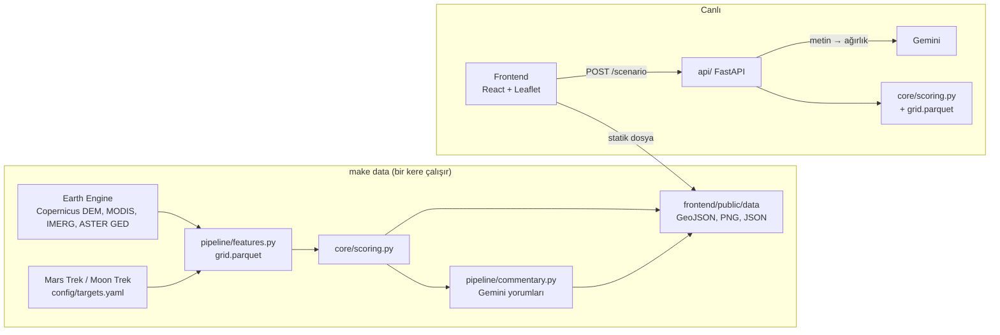

# GeoCosmos — Mimari ve Teknoloji Seçimleri

> Bu dosya projenin **nasıl** yapıldığını anlatır. **Ne zaman** ve **kim** sorularının cevabı için [ROADMAP.md](ROADMAP.md).

## İçindekiler

- [Temel kararlar](#temel-kararlar)
- [Genel akış](#genel-akış)
- [Teknoloji seçimleri](#teknoloji-seçimleri)
- [Veri saklama](#veri-saklama)
- [Veri sözleşmesi](#veri-sözleşmesi)
- [API](#api)
- [Gemini kullanımı](#gemini-kullanımı)
- [Frontend notları](#frontend-notları)
- [Klasör yapısı](#klasör-yapısı)
- [Kurulum ve komutlar](#kurulum-ve-komutlar)
- [Ortam değişkenleri](#ortam-değişkenleri)
- [Yayınlama](#yayınlama)
- [Bilinçli olarak yapmadıklarımız](#bilinçli-olarak-yapmadıklarımız)

---

## Temel kararlar

1. **Tek dil Python.** Puanlama motoru bir kere yazılır; hem veri hattı hem API aynı `core/` paketini kullanır.
2. **Veritabanı sunucusu yok.** Kullanıcı kaydı ve kullanıcıdan gelen veri olmadığı için veriler dosyada durur (Parquet, GeoJSON, PNG).
3. **Ağır iş önceden yapılır.** Puanlar ve Gemini yorumları `make data` ile bir kere üretilir. Canlı çalışan tek parça, serbest metin senaryosu.
4. **Backend çökse de demo çalışır.** Frontend, hazır sonuçları statik dosyalardan okur. Backend sadece `/scenario` için gerekir.
5. **Gemini sayı üretmez.** Sayıları her zaman bizim motorumuz hesaplar; Gemini ya yorum yazar ya da metni ağırlıklara çevirir.

## Genel akış



## Teknoloji seçimleri

### Veri hattı (`pipeline/`)

| İş | Araç | Neden |
| --- | --- | --- |
| Uydu verisini karelere indirmek | `earthengine-api` | Ağır işlem Google sunucusunda; laptopa sadece tablo iner |
| Tablo işleri | `pandas`, `numpy` | 240 bin satırı saniyeler içinde puanlar |
| Coğrafi işler | `geopandas`, `shapely` | Mesafe filtresi, GeoJSON yazma |
| Normalizasyon | Tolerans formülü (`core/scoring.py`) | Her parametre kendi biriminde, `test_profiles.yaml > tolerance` ile 0–1 benzerliğe çevrilir; ek kütüphane gerekmez |
| Ölçek eşitleme | Earth Engine `reduceResolution` | Eğim/pürüzlülük öncesi tüm yükseklik verileri 500 m'ye indirilir (`config/grid.yaml`) |
| NetCDF okuma | `xarray`, `netCDF4` | ESA CCI Permafrost dosyası Earth Engine'de yok; yerelde ızgaraya ortalanır |
| Ayar dosyaları | `pyyaml` | Hedefler ve ağırlıklar kodda değil, dosyada |
| Isı haritası | `matplotlib` | Dünya geneli benzerliği PNG olarak çizer |
| Gemini | `google-genai` | Google'ın resmi Python kütüphanesi |

### Backend (`api/`)

| İş | Araç |
| --- | --- |
| Web sunucusu | FastAPI + Uvicorn |
| Veri kontrolü | Pydantic (`core/schemas.py`) |
| Gemini önbelleği | JSON dosyası ya da SQLite |

### Frontend (`frontend/`)

| İş | Araç | Neden |
| --- | --- | --- |
| Çatı | React + Vite | Yaygın, hızlı, örneği bol |
| Dil | TypeScript (ekip bilmiyorsa JavaScript) | Veri formatı hatalarını erken yakalar |
| Harita | Leaflet + `react-leaflet` | Basit, hafif, Ay/Mars katmanı eklenebilir |
| Radar grafik | Recharts | Hazır `RadarChart` bileşeni |
| Tasarım | Tailwind CSS | Karanlık uzay temasını hızlı kurar |

## Veri saklama

| Veri | Format | Kim okur | Repo'ya girer mi |
| --- | --- | --- | --- |
| Earth Engine ham çıktıları | CSV | `pipeline/` | Hayır (`data/raw/` gitignore) |
| Tüm Dünya ızgarası (~240 bin kare) | Parquet | `api/`, `pipeline/` | 100 MB altındaysa evet, değilse GitHub Releases |
| Hedefler | GeoJSON | Frontend | Evet |
| Hazır test sonuçları (hedef × test) | GeoJSON | Frontend | Evet |
| Dünya geneli ısı haritaları | PNG | Frontend | Evet |
| Doğrulama tablosu | JSON | Frontend | Evet |
| Gemini yorumları | GeoJSON içinde | Frontend | Evet |

- **Parquet:** Sıkıştırılmış tablo dosyası. CSV'den 5–10 kat küçük, çok daha hızlı okunur.
- SQL istenirse **DuckDB** sunucusuz olarak doğrudan Parquet'e sorgu atabilir (opsiyonel).
- Gerçek bir veritabanı ancak kullanıcı hesabı veya kayıtlı senaryo gibi özellikler eklenirse gerekir; hackathon kapsamında yok.

### Earth Engine'e bağımlılık

`grid.parquet` olmadan API `/scenario` için 503 döner, doğrulama testi atlanır ve analog dosyaları üretilmez. Bu riski **sahte veri üretmeden** şöyle küçültürüz:

1. **Tek kişi export eder, herkes kullanır.** `grid.parquet` commit'lenir (100 MB altındaysa). Ekipte sadece bir kişinin Earth Engine hesabı yeterlidir.
2. **Önce küçük ama gerçek bir bölge.** Tüm Dünya exportu beklenirken bir kutu export edilir; API, `make data` ve frontend bu gerçek verilerle geliştirilir:
   ```bash
   python -m pipeline.ee_export --bbox -112 37 -109 40      # Hanksville çevresi, birkaç dakika
   python -m pipeline.features                                # data/raw/*.csv -> grid.parquet
   ```
   Bu dosya bölgesel olduğu için doğrulama ve keşif sonuçları **sunumda kullanılmaz**; tüm Dünya exportu gelince üzerine yazılır.
3. **Sentetik ızgara yok.** Motorun birim testleri `tests/` içindeki küçük, elle yazılmış tablolarla çalışır; bunlar uygulamaya veri olarak hiç girmez.

## Veri sözleşmesi

Python tarafı ve frontend aynı formata bağlıdır. Bu format **hackathonun ilk 2 saatinde dondurulur**; frontend o andan itibaren sahte veriyle çalışmaya başlar. Değişiklik gerekirse önce bu bölüm güncellenir, sonra kod.

- Python: `core/schemas.py` (Pydantic modelleri)
- Frontend: `frontend/src/types.ts`

### Hedef (`targets.geojson` → her `feature.properties`)

```json
{
  "id": "mars_jezero",
  "body": "mars",
  "name": "Jezero Krateri",
  "why": "Perseverance, antik delta",
  "params": {
    "slope_deg": { "value": 3.5, "source": "MOLA" },
    "temp_range_c": { "value": 80, "source": "THEMIS" }
  }
}
```

### Analog (`analogs/<hedef>_<test>.geojson` → her `feature.properties`)

```json
{
  "id": "analog_001",
  "name": "Aday bölge adı",
  "is_new": true,
  "target_id": "mars_jezero",
  "test_id": "biosignature_carbonate",
  "lat": 64.85,
  "lon": -16.82,
  "rank": 1,
  "score_total": 82,
  "scores": { "topography": 75, "geology": 90, "climate": null },
  "params": [
    { "key": "slope_deg", "earth": 4.1, "target": 3.5, "source": "Copernicus DEM GLO-30", "match": true }
  ],
  "ops_tags": { "road_access": true, "remote": true },
  "breakdown": ["gravity", "atmosphere", "liquid_water"],
  "past_tests": [{ "title": "...", "url": "..." }],
  "ai_comment": "..."
}
```

### Arayüz etiketleri (`meta.json`)

`make data` her zaman üretir. Test adları, parametre etiketleri, kopma açıklamaları (`core/breakdown.py`) ve test gerekçeleri tek kaynaktan, `config/`'ten gelir; frontend metin tekrarlamaz. Tipi: `Meta` (`frontend/src/types.ts`).

### Analog listesi (`analogs/index.json`)

Hangi hedef × test dosyasının var olduğunu ve neden olmadığını söyler. Frontend dosya adını tahmin etmek yerine buradan okur.

```json
[
  { "target_id": "mars_jezero", "test_id": "rover", "file": "mars_jezero_rover.geojson",
    "count": 20, "new_count": 17, "params_used": ["aridity", "mafic_index"], "params_total": 6 },
  { "target_id": "moon_malapert", "test_id": "dust", "file": null, "count": 0,
    "reason": "Hedefte bu testin parametrelerinden hiçbiri yok (config/targets.yaml)" }
]
```

`params_used` / `params_total`: hedefte değeri girilmiş parametre sayısı. Düşükse kartta "bu sonuç X/Y parametreyle hesaplandı" uyarısı gösterilmeli.

### Doğrulama (`validation.json`)

```json
{
  "hits": 3, "min_hits": 3, "holdout_total": 4, "top_percent": 1, "passed": true, "denominator": 152340,
  "analogs": [
    { "id": "salda", "name": "Salda Gölü kıyısı (Türkiye)", "test_id": "biosignature_carbonate", "split": "holdout",
      "targets": ["mars_jezero"], "status": "ok", "target_id": "mars_jezero",
      "score_total": 71.2, "rank": 840, "percentile": 0.551, "hit": true, "cell_id": "g25_37.550_29.680",
      "note": "...", "past_tests": [{ "title": "...", "url": "..." }] }
  ]
}
```

`status`: `ok` · `missing_cell` (grid'de karesi yok, ör. bölgesel grid) · `no_target_values` (hedefte bu testin değeri yok). `hit` sadece `ok` kayıtlarda vardır.

### Isı haritaları (`heatmaps/index.json` + `heatmaps/<hedef>_<test>.png`)

```json
{ "crs": "EPSG:3857", "bounds": [[-85, -180], [84, 180]], "value": "score_total",
  "vmin": 0, "vmax": 100, "colormap": "magma",
  "files": [{ "target_id": "mars_jezero", "test_id": "rover", "file": "mars_jezero_rover.png" }] }
```

PNG satırları Web Mercator'dadır; Leaflet'te `L.imageOverlay(url, bounds)` ile doğrudan oturur. Saydam pikseller: veri yok ya da maskeli.

### Sabit kimlikler

| Alan | Değerler |
| --- | --- |
| `body` | `moon`, `mars` |
| `test_id` | `rover`, `ice_drilling`, `lava_tube`, `dust`, `biosignature_arid`, `biosignature_carbonate`; `/scenario` sonuçlarında `custom` |
| `breakdown` | `gravity`, `atmosphere`, `radiation`, `liquid_water`, `biology`, `temperature` (mutlak sıcaklık; buz sondajı dışında puana girmez) |
| `scores` anahtarları | `topography`, `geology`, `climate`. Değer `null` olabilir: o test amacında o boyuta ağırlık verilmemiştir (radarda boş). Operasyon bilgisi puan değil, `ops_tags` |
| `ops_tags` anahtarları | `road_access`, `remote` (`config/grid.yaml > ops_tags`) |
| Analog `lat`, `lon` | Karenin Dünya'daki merkezi (derece, `lon` -180..180). Statik GeoJSON'da `geometry` ile aynı değerdir; `/scenario` yanıtında `geometry` olmadığı için pin bu alanlardan çizilir |

## API

Hazır sonuçlar statik dosyadır; API sadece canlı senaryo içindir.

| Metot | Yol | Girdi | Çıktı |
| --- | --- | --- | --- |
| `GET` | `/health` | — | `{"status": "ok"}` |
| `POST` | `/scenario` | `{"text": "...", "target_id": "mars_jezero"}` | Ağırlıklar + en iyi 20 analog (veri sözleşmesindeki formatta) |

`/scenario` akışı:

1. Gemini metni JSON ağırlıklara çevirir (şemaya zorlanmış çıktı).
2. Ağırlıklar kontrol edilir: bilinmeyen anahtarlar atılır, toplam 1'e normalize edilir.
3. Dünya'da karşılığı olmayan istekler (düşük yerçekimi, vakum gibi) için `unsupported` alanı doldurulur.
4. `core/scoring.py`, belleğe yüklenmiş `grid.parquet` üzerinde sıralama yapar. Tek yönlü (`at_least`) kurallar hazır testlerden gelir: bir parametre onu kullanan her hazır testte `at_least` ise serbest metinde de öyledir (şu an karbonat; `core/profiles.py > custom_at_least`). Gemini bu kurala karar vermez.
5. Aynı metin için sonuç önbellekten döner.

## Gemini kullanımı

| Görev | Ne zaman | Girdi | Çıktı | Kural |
| --- | --- | --- | --- | --- |
| Yorumcu | `make data` sırasında | Analogun JSON'u | 1–2 paragraf açıklama | Sadece verilen değerleri kullan, yeni sayı ekleme, benzemeyen yönleri yaz |
| Tercüman | Canlı (`/scenario`) | Kullanıcı metni + parametre listesi | `{"weights": {...}, "unsupported": [...]}` | Sadece listedeki parametreleri kullan |

- API anahtarı sadece sunucuda durur (`.env`), tarayıcıya hiç gitmez.
- Yorumcu çıktısında motorda olmayan bir sayı varsa o yorum yeniden üretilir.
- "Geçmiş testler" bilgisi Gemini'ye yazdırılmaz; elle ve kaynaklı girilir.

## Frontend notları

| Yol | Sayfa | Okuduğu |
| --- | --- | --- |
| `/` | Giriş: gök cismi seçimi | `targets.geojson` |
| `/mars`, `/moon` | Dönen Ay/Mars küresi (NASA Trek mozaiği) üzerinde hedefler, hedef ve test seçimi | `targets.geojson`, `meta.json`, `analogs/index.json` |
| `/:body/:hedef/:test` | Dünya haritası (NASA GIBS), ısı haritası, adaylar, analog kartı, senaryo kutusu | `analogs/<hedef>_<test>.geojson`, `heatmaps/index.json`, `POST /scenario` |
| `/dogrulama` | Doğrulama paneli | `validation.json` |
| `/bulgular` | Halka açık bulgular: üç yıldız aday (anlatı elle, sayılar dosyalardan), Dünya'nın taklit edemedikleri, dürüst sınırlar. Uydu görüntüsü NASA GIBS WMS | `meta.json`, `targets.geojson`, `analogs/*`, `validation.json` |

- **Taban haritalar challenge kaynaklarından:** Ay/Mars için NASA Trek WMTS karoları (Viking MDIM 2.1 renkli mozaik, LRO WAC mozaik) birleştirilip WebGL küresine sarılır (`PlanetGlobe.tsx`), Dünya için NASA GIBS (Worldview) Blue Marble (Web Mercator).
- Harita ve grafik kütüphaneleri ayrı parçada yüklenir (`React.lazy`); giriş sayfası onları beklemez.

- **Büyük veri tarayıcıya gitmez.** Haritaya sadece en iyi adaylar pin olarak gelir; Dünya geneli görünüm hazır PNG ısı haritasıdır (Leaflet `ImageOverlay`).
- **Ay ve Mars haritaları Dünya projeksiyonunda değildir.** Moon Trek / Mars Trek katmanları hackathon öncesi denenir. B planı: tek büyük görsel + `CRS.Simple` + `ImageOverlay`.
- Backend'e ulaşılamazsa senaryo kutusu "şu an çevrimdışı" der; geri kalan her şey çalışmaya devam eder.
- **Port sabit:** `vite.config.ts` içinde `server: { port: 5173, strictPort: true }`. 5173 doluysa Vite 5174'e kaymaz, hata verir; böylece API'nin CORS listesiyle uyuşmayan bir adresten sessizce çalışmaz.

## Klasör yapısı

```
GeoCosmos/
├── core/                     # Paylaşılan Python paketi: motorun kalbi
│   ├── __init__.py
│   ├── schemas.py            # Pydantic modelleri = veri sözleşmesi
│   ├── scoring.py            # ağırlıklı benzerlik
│   ├── breakdown.py          # kopma kuralları
│   └── profiles.py           # test ağırlıklarını yükler
│
├── pipeline/                 # Bir kere çalışan işler (offline)
│   ├── ee_export.py          # Earth Engine → CSV
│   ├── features.py           # CSV → normalize edilmiş grid.parquet
│   ├── target_values.py      # Mars/Ay DEM → hedef eğim/pürüzlülük (Dünya ile aynı kural; PDS'ten uzaktan)
│   ├── mars_climate.py       # Mars hedefleri: sıcaklık, toz (Mars Climate Database)
│   ├── diviner_polar.py      # Ay kutup hedefleri: sıcaklık, buz kararlılığı (Diviner PRP)
│   ├── permafrost.py         # ESA CCI Permafrost NetCDF → kare başına ground_ice (yerel)
│   ├── discovery.py          # global kaba + yakın tarama
│   ├── validation.py         # ünlü analog testi
│   ├── commentary.py         # Gemini yorumları
│   ├── heatmap.py            # PNG ısı haritaları (Web Mercator)
│   └── build.py              # hepsini sırayla çalıştırır
│
├── api/                      # Canlı FastAPI sunucusu
│   ├── main.py
│   ├── routes/scenario.py
│   └── services/gemini.py
│
├── config/
│   ├── targets.yaml          # 6 Ay/Mars hedefi + kaynaklar
│   ├── test_profiles.yaml    # 6 test amacı = 6 ağırlık seti
│   ├── known_analogs.yaml    # doğrulama seti (ayar / sınav / rapor) + keşif dışı bilinen sahalar
│   └── grid.yaml             # ızgara boyutu, eğim ölçeği, maske kuralları
│
├── data/
│   ├── raw/                  # gitignore
│   └── processed/            # grid.parquet
│
├── frontend/
│   ├── public/data/          # build.py buraya yazar (commit'lenir)
│   │   ├── targets.geojson
│   │   ├── analogs/          # <hedef>_<test>.geojson
│   │   ├── heatmaps/         # <hedef>_<test>.png
│   │   └── validation.json
│   └── src/
│       ├── components/
│       │   ├── PlanetGlobe.tsx
│       │   ├── EarthMap.tsx
│       │   ├── AnalogCard.tsx
│       │   ├── ScoreRadar.tsx
│       │   ├── BreakdownBox.tsx
│       │   └── ScenarioChat.tsx
│       ├── services/api.ts
│       ├── types.ts          # veri sözleşmesinin TS hâli
│       └── App.tsx
│
├── tests/
│   ├── test_core.py          # motor, config tutarlılığı
│   ├── test_features.py      # CSV → grid.parquet (Earth Engine'siz)
│   ├── test_ee_export.py     # şerit planı ve kare ızgara
│   ├── test_target_values.py # hedef DEM hesabı
│   ├── test_api.py           # CORS
│   ├── test_permafrost.py    # NetCDF → ground_ice
│   ├── test_pipeline.py      # discovery → validation → heatmap → commentary → build
│   ├── test_target_sources.py # Diviner PRP ve Mars Climate Database (ağsız)
│   └── test_validation.py    # "sınav yerleri en iyi %1'de mi?" otomatik testi
├── notebooks/
├── docs/
├── requirements.txt
├── Makefile
├── .env.example
├── ARCHITECTURE.md
├── DATA_SOURCES.md
├── STATUS.md                 # yapılanlar / yapılacaklar
├── ROADMAP.md
└── README.md
```

| Klasör | Sahibi | Not |
| --- | --- | --- |
| `core/` | B | Hem `pipeline/` hem `api/` buradan import eder; tek doğruluk kaynağı |
| `pipeline/` | A | İnternet + Earth Engine gerektirir; demo sırasında çalışmaz |
| `api/` | B | Sadece `core/` + `grid.parquet` + Gemini |
| `frontend/` | C | Sadece `public/data/` ve `/scenario` ile konuşur |
| `config/` | A | Ağırlık değişikliği kod değişikliği gerektirmez |
| `tests/` | B | Doğrulama ölçütü otomatik test olarak çalışır |

## Kurulum ve komutlar

```bash
# Python ortamı
python -m venv .venv
source .venv/bin/activate        # Windows: .venv\Scripts\activate
pip install -r requirements.txt

# Earth Engine girişi (bir kere)
earthengine authenticate

# Frontend
cd frontend && npm install
```

| Komut | Ne yapar |
| --- | --- |
| `make preview` | Earth Engine bağlantı denemesi (Salda çevresinden 5 satır) |
| `make export` | Tüm karaları Drive'a CSV olarak export eder (61 görev) |
| `make grid` | `data/raw/*.csv` (+ `data/raw/permafrost/*.nc`) → `data/processed/grid.parquet` |
| `make data` | `pipeline/build.py`: hedefler, analoglar, doğrulama, ısı haritaları, Gemini yorumları |
| `make api` | FastAPI sunucusunu açar (`localhost:8000`) |
| `make web` | Frontend'i açar (`localhost:5173`) |
| `make test` | Tüm testler (GitHub Actions her push'ta da çalıştırır) |

## Ortam değişkenleri

`.env.example` dosyası repo'ya girer, `.env` asla girmez.

```
GEMINI_API_KEY=
GEMINI_MODEL=gemini-3.5-flash-lite
EE_PROJECT=
EE_PERMAFROST_ASSETS=
API_ALLOWED_ORIGIN=http://localhost:5173,http://127.0.0.1:5173
VITE_API_URL=http://localhost:8000
```

`API_ALLOWED_ORIGIN` virgülle ayrılmış liste alır; sondaki `/` temizlenir. Boşsa `localhost:5173` ve `127.0.0.1:5173` kullanılır. Yayında frontend adresini buraya ekleyin, örn. `http://localhost:5173,https://geocosmos.vercel.app`.

## Yayınlama

| Parça | Nerede | Not |
| --- | --- | --- |
| Frontend | **GitHub Pages** (`.github/workflows/pages.yml`) | Statik; `VITE_BASE=/GeoCosmos/`; derin bağlantılar için `404.html`. Kurulum: STATUS.md > Yayın |
| Backend | Render, Railway veya Hugging Face Spaces | Ücretsiz planlar uyuyabilir; demodan 5 dk önce uyandırın. Koşulları önceden kontrol edin |
| Yedek | Laptopta `make api` + `make web` | İnternet yoksa demo buradan |

## Bilinçli olarak yapmadıklarımız

| Ne | Neden |
| --- | --- |
| Go backend | Aynı motoru iki dilde yazmak demek |
| PostgreSQL / PostGIS | Yazılan veri yok; kurulum ve yayınlama yükü |
| Model eğitimi / fine-tuning | 48 saatte gerçekçi değil; Gemini'yi tercüman olarak kullanmak yetiyor |
| 3D küre | Çok zaman alır; 2D harita aynı hikâyeyi anlatıyor |
| Tüm ızgarayı tarayıcıya göndermek | Sayfa donar; pin + PNG ısı haritası yeterli |
