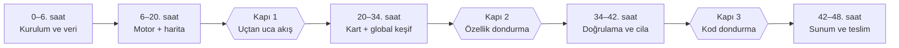

# GeoCosmos — Yol Haritası

> Ay ve Mars'taki bir hedef ve bir test amacı için, Dünya'nın tamamını NASA verisiyle tarayıp en uygun test alanlarını bulan; benzerliğin nerede koptuğunu da dürüstçe gösteren analog keşif aracı.

**Varsayım:** Hackathon 48 saat, ekip 3 kişi. Farklıysa saatler orantılı olarak kaydırılır.

## İçindekiler

- [Özet](#özet)
- [Challenge'a uygunluk](#challengea-uygunluk)
- [Ürün ve kullanıcı akışı](#ürün-ve-kullanıcı-akışı)
- [Veri ve hedefler](#veri-ve-hedefler)
- [Global keşif modu](#global-keşif-modu)
- [Mimari ve klasör yapısı](#mimari-ve-klasör-yapısı)
- [Hackathon öncesi hazırlık](#hackathon-öncesi-hazırlık)
- [48 saatlik plan](#48-saatlik-plan)
- [Görev dağılımı](#görev-dağılımı)
- [MVP ve atılabilecekler](#mvp-ve-atılabilecekler)
- [Riskler ve B planları](#riskler-ve-b-planları)
- [Sunum ve demo senaryosu](#sunum-ve-demo-senaryosu)

---

## Özet

GeoCosmos şu soruyu cevaplar: **"Ay'daki ya da Mars'taki bu yerde yapılacak bu testi, Dünya'da nerede prova ederim?"**

- Dünya'nın tüm karaları NASA verisiyle taranır ve her bölge, seçilen test amacına göre puanlanır.
- Her sonuçta benzerliğin bittiği yer açıkça gösterilir (yerçekimi, atmosfer, radyasyon, sıvı su).
- Ünlü analoglar keşif listesine girmez, motorun doğruluğunu kanıtlamak için kullanılır.
- Asıl hedef, listede olmayan **yeni adaylar** bulmaktır.

Jüriye vaadimiz: Tek bir "benzerlik yüzdesi" değil, test amacına göre veriyle kanıtlanmış ve sınırları açıkça söylenmiş bir analog önerisi.

## Challenge'a uygunluk

| Challenge ne istiyor | GeoCosmos'ta nasıl karşılanıyor |
| --- | --- |
| Dünya genelinde sistematik arama | Tüm karalar iki aşamalı ızgarayla taranıyor (25 km → 5 km) |
| Görsel benzerliğin ötesine geç | 4 boyutlu skor (topoğrafya, jeoloji, iklim, operasyon), her sayı NASA verisinden |
| Analojinin koptuğu yeri göster | Her kartta kopma kutusu ve parametre bazında "benzemiyor" işareti |
| Bilinen yerleri tekrarlama | Ünlü analoglar sadece doğrulama seti; keşif modu yeni aday buluyor |
| Ay üssü adayları / Mars iniş alanları | Artemis güney kutbu bölgeleri, Arcadia Planitia gibi gelecek görev hedefleri |
| Süreçleri düşün | Test amaçları süreç bazlı: toz ve rüzgar aşınması, donmuş zemin, suyla oluşan karbonat |
| Keşifle bağlantı kur | 5 test amacı gerçek görev ihtiyaçlarından geliyor |
| Yaratıcı yöntem | Amaca göre ağırlıklı benzerlik + Gemini ile serbest metinden parametre çıkarma |
| NASA ve diğer ajans verisi | SRTM, MODIS, ASTER, EMIT, MOLA, THEMIS, LOLA, Diviner, ESA WorldCover |

## Ürün ve kullanıcı akışı

1. **Gezegen seçimi:** Ay veya Mars haritasında hedef bölgeler işaretli. Üstüne gelince açılan popup, hedefin parametrelerini gösterir.
2. **Test amacı:** Hedefe tıklayınca 5 hazır testten biri seçilir ya da serbest metin yazılır (Gemini metni parametre ağırlıklarına çevirir).
   - Rover sürüşü ve tekerlek aşınması
   - Donmuş zeminde buz sondajı (ISRU)
   - Lav tüpü ve yeraltı habitatı
   - Toz fırtınası ve aşınma
   - Biyo-imza ve antik yaşam izi
3. **Dünya haritası:** Puanlanmış analoglar pin olarak çıkar. Keşif modunun bulduğu yeni adaylar ayrı renkte, "Yeni aday" etiketiyle gösterilir.
4. **Analog kartı:** Pine tıklayınca açılır:
   - Radar grafik (4 skor)
   - Hedef ve Dünya değerleri yan yana, her değerin yanında veri kaynağı
   - Geçmiş testler rozeti (elle girilmiş, kaynak linkli)
   - Kopma kutusu
   - Önceden üretilmiş Gemini yorumu
5. **Doğrulama paneli:** "NASA ve ESA'nın kullandığı ünlü analoglar bizim motorumuzda kaçıncı sırada?"

## Veri ve hedefler

Her sayının bir kaynağı var. Elle girilen her değer `"kaynak": "elle — <makale/link>"` etiketi taşır.

### Hedefler (3 Ay + 3 Mars)

| Gök cismi | Hedef | Neden seçildi | Öne çıkan özellik |
| --- | --- | --- | --- |
| Ay | Shackleton Krateri kenarı | Artemis güney kutbu üs bölgesi | Kalıcı gölge, olası buz, dik eğim |
| Ay | Malapert Masifi | Artemis aday bölgelerinden biri | Uzun güneşlenme, Dünya ile görüş hattı |
| Ay | Marius Hills çukuru | Lav tüpü girişi | Yeraltı habitatı, radyasyon korunması |
| Mars | Jezero Krateri | Perseverance, antik delta | Kil ve karbonat, biyo-imza hedefi |
| Mars | Gale Krateri | Curiosity, katmanlı çökeller | Sülfat ve kil, kumullar, rüzgar aşınması |
| Mars | Arcadia Planitia | İnsanlı iniş adayı | Yüzeye yakın buz, düz arazi |

> Hedef listesi ve koordinatlar hackathon öncesinde NASA kaynaklarından son kez doğrulanacak.

### Parametreler ve kaynaklar

| Parametre | Dünya verisi | Mars verisi | Ay verisi | Skor |
| --- | --- | --- | --- | --- |
| Eğim ve pürüzlülük | SRTM | MOLA | LOLA | Topoğrafya |
| Yüzey sıcaklığı, gece-gündüz farkı | MODIS LST | THEMIS, TES | Diviner | İklim |
| Yüzey malzemesi ve mineral | ASTER, EMIT | CRISM, TES | LROC, Lunar Prospector | Jeoloji |
| Kuraklık ve bitki yokluğu | MODIS NDVI, GPM yağış | Hep kuru (sabit) | Hep kuru (sabit) | İklim |
| Toz ve aerosol | MODIS AOD, MERRA-2 | TES toz opaklığı | Yok | İklim |
| Buz ve donmuş zemin | Permafrost ve kar örtüsü haritaları | SHARAD, SWIM buz haritaları | Diviner, LRO LEND | Jeoloji |
| Arazi örtüsü (sadece filtre) | ESA WorldCover | — | — | — |

Mars ve Ay hedefleri için her parametre tek değerdir (Mars Trek / Moon Trek veya makaleden). Operasyonel bilgiler (GPS yokluğu, ulaşım) puan değil, kartta ✓/✗ etiketi olarak gösterilir.

### Doğrulama seti

Ünlü analoglar motoru test etmek için kullanılır, keşif listesine girmez:

| Yer | Beklenen test amacı |
| --- | --- |
| Holuhraun (İzlanda) | Rover sürüşü |
| Yungay (Atacama, Şili) | Biyo-imza / aşırı kuraklık |
| Haughton Krateri (Devon Adası, Kanada) | Buz sondajı |
| Svalbard (Norveç) | Buz sondajı |
| Lanzarote lav tüpleri (İspanya) | Lav tüpü ve habitat |
| Dumont Dunes (Mojave, ABD) | Rover sürüşü |
| Lut Çölü (İran) | Toz ve aşınma |
| Salda Gölü (Türkiye) | Biyo-imza |

**Başarı ölçütü:** 8 yerden en az 6'sı kendi test amacında ilk 3'e girmeli.

## Global keşif modu

Tüm Dünya iki aşamada taranır. Ağır işlem Earth Engine'de, puanlama lokalde yapılır.

| Aşama | Ne yapılır | Boyut |
| --- | --- | --- |
| 1. Kaba tarama | Tüm karalar 25 km'lik karelerle puanlanır | ~240 bin kare |
| 2. Filtre | Şehir, tarım, su (ESA WorldCover) çıkarılır; bilinen analoglara 50 km'den yakın kareler doğrulama setine ayrılır | — |
| 3. Yakın tarama | Her test amacı için en iyi 50–100 karenin çevresi 5 km'lik karelerle yeniden puanlanır | Birkaç bin kare |
| 4. Elle kontrol | En iyi 3–5 aday Landsat görüntüsüyle incelenir, en ilginç 1–2'si sunuma taşınır | — |

- 25 km ızgarada 6 parametrelik tablo ~10–20 MB tutar; 8 GB RAM'li laptopta rahat çalışır.
- Ham uydu verisi laptopa indirilmez. Earth Engine'de karelere küçültülür, sadece sonuç tablosu (CSV) indirilir.
- Sonucu biz seçmeyiz, motor söyler. Beklenmedik bir aday çıkarsa sunumun en güçlü anı o olur.

## Mimari ve klasör yapısı

Teknoloji seçimleri, veri sözleşmesi, API, Gemini kuralları ve klasör yapısı **[ARCHITECTURE.md](ARCHITECTURE.md)** dosyasında. Kısaca:

| Katman | Seçim |
| --- | --- |
| Veri işleme | Python + Earth Engine + pandas/geopandas |
| Backend | FastAPI (tek canlı endpoint: `/scenario`) |
| AI | Gemini (`google-genai`), JSON şemalı çıktı; sayı üretmez |
| Veri saklama | Parquet + GeoJSON + PNG (veritabanı sunucusu yok) |
| Frontend | React + Vite + Leaflet + Recharts + Tailwind |
| Yayınlama | Frontend: GitHub Pages / Vercel · Backend: Render / HF Spaces |

## Hackathon öncesi hazırlık

- [ ] Resmi kuralları okuyun: Önceden ne hazırlanabilir (kod, veri, sadece fikir)? Teslim şartları neler (video süresi, demo linki, proje sayfası)?
- [ ] Herkes Google Earth Engine hesabı açsın (onay gecikebilir, en erken iş bu).
- [ ] Earth Engine'de **tüm karalar için** 25 km'lik tek bir katmanı (SRTM eğim) CSV olarak dışa aktarmayı deneyin. Süreyi not edin.
- [ ] Gemini API anahtarı alın, ücretsiz kullanım limitlerini not edin.
- [ ] Moon Trek ve Mars Trek katmanlarını Leaflet'te deneyin. Çalışmazsa B planı statik mozaik görüntü.
- [ ] 6 hedefin koordinatlarını ve parametre değerlerini kaynaklarıyla `targets.yaml` dosyasına yazın.
- [ ] Doğrulama setindeki 8 yer için geçmiş test kaynaklarını (link) toplayın.
- [ ] Her test amacı için ağırlıkların ilk taslağını yazın (`test_profiles.yaml`).
- [ ] Repo, klasör iskeleti, `.gitignore` ve rol dağılımı hazır olsun.
- [ ] Veri sözleşmesini ([ARCHITECTURE.md](ARCHITECTURE.md#veri-sözleşmesi)) birlikte okuyun; hackathonun ilk 2 saatinde dondurulacak.

## 48 saatlik plan

Kapı 1'de, yani 20. saatte, basit ama uçtan uca çalışan bir sürüm olmalı: hedef seç → test seç → Dünya haritasında puanlı pinleri gör. Sonrası bu iskeleti zenginleştirmek. **34. saatten sonra yeni özellik eklenmez.**

| Aşama | Saat | Çıktı |
| --- | --- | --- |
| Kurulum ve veri | 0–6 | Repo çalışıyor, hedef değerleri hazır, ilk Earth Engine exportu başladı |
| Motor + harita | 6–20 | Skor motoru, kopma kuralları, Ay/Mars + Dünya haritası, ilk uçtan uca akış |
| Kart + global keşif | 20–34 | Analog kartı, kaba + yakın tarama sonuçları, kayıtlı Gemini yorumları |
| Doğrulama ve cila | 34–42 | Doğrulama tablosu, hata düzeltme, arayüz cilası |
| Sunum ve teslim | 42–48 | Demo videosu, sunum provası, teslim |

Her kapıda 10 dakikalık ekip kontrolü yapılır. Kapı geçilemiyorsa [MVP tablosunun](#mvp-ve-atılabilecekler) alt satırları atılır.

## Görev dağılımı

| Kişi | Rol | 0–20. saat | 20–34. saat | 34–48. saat |
| --- | --- | --- | --- | --- |
| A | Veri, keşif ve bilim | Hedef ve Dünya parametreleri, Earth Engine exportları, test ağırlıkları | Global kaba + yakın tarama, filtreler, adayların elle kontrolü | Doğrulama, veri kaynak listesi, rapor |
| B | Motor, backend ve AI | Skor motoru, kopma kuralları, GeoJSON çıktısı | FastAPI senaryo servisi, Gemini tercüman + yorumcu | Hata düzeltme, demo yedeği |
| C | Frontend ve sunum | Ay/Mars ve Dünya haritası, pinler | Analog kartı, radar, doğrulama paneli | Arayüz cilası, demo videosu, pitch |

## MVP ve atılabilecekler

| Öncelik | Özellik |
| --- | --- |
| Olmazsa olmaz | 6 hedef, 5 test amacı, en az 5 parametre NASA verisinden |
| Olmazsa olmaz | Ağırlıklı skor motoru ve kopma kuralları |
| Olmazsa olmaz | Ay/Mars haritası, Dünya haritası, analog kartı ve kopma kutusu |
| Olmazsa olmaz | Doğrulama tablosu |
| Olmazsa olmaz | Global kaba tarama sonucu (önceden hesaplanmış, en az 1 yeni aday) |
| Olmazsa olmaz | Kayıtlı Gemini yorumları |
| Olursa iyi | 5 km yakın tarama |
| Olursa iyi | Serbest metinli Gemini senaryo çözücü (canlı) |
| Olursa iyi | Radar grafik |
| Olursa iyi | Ay/Mars haritasında Trek katmanı (yoksa statik görüntü) |
| Atılabilir | 3D küre |
| Atılabilir | Mobil uyum, kullanıcı hesabı |

## Riskler ve B planları

| Risk | Fark etme anı | B planı |
| --- | --- | --- |
| Global Earth Engine exportu uzun sürer | 6. saatte veri yok | Izgarayı 50 km'ye büyüt ya da kıtaları sırayla export et; bu sırada elle girilmiş değerlerle devam |
| Laptop belleği yetmez | Script kilitleniyor | Daha kaba ızgara; tabloyu kıta kıta işle |
| Gemini limiti dolar / internet kesilir | Canlı çağrı hata veriyor | Kayıtlı yorumlar; senaryo çözücü için 3 hazır örnek cevap |
| Gemini sayı uydurur | Yorumda motorda olmayan sayı var | Prompt'ta yasak, çıktıda sayı kontrolü; geçmiş testler elle girilir |
| Keşif anlamsız yer bulur | Tarla, şehir, deniz, buz tabakası çıkıyor | WorldCover maskesi; buz tabakalarını sadece buz testinde tut |
| Doğrulama tutmaz | Ünlüler alt sırada | Ağırlıkları ayarla ama sonucu dürüstçe raporla |
| Ay/Mars harita katmanı yüklenmez | Boş harita | Statik mozaik görüntü |
| Canlı demo çöker | Sunum anı | Demo videosu hazır, yerel sunucu yedekte |

## Sunum ve demo senaryosu

Sunumun omurgası: **"NASA'nın kullandığı yerleri motorumuz kendi buldu. Aynı motor tüm Dünya'yı taradı ve yeni adaylar buldu."**

Toplam 3 dakika (resmi süre farklıysa oranlar korunur):

1. **Problem (30 sn):** Test sahası seçimi bugün çoğunlukla uzman deneyimine dayanıyor. Tek bir "benzerlik yüzdesi" yanıltıcı: Bir yer rover testi için mükemmel, buz sondajı için işe yaramaz olabilir.
2. **Yöntem (40 sn):** Test amacına göre ağırlıklı skor, her sayı NASA verisinden, kopma kutusu benzerliğin bittiği yeri söylüyor.
3. **Kanıt (25 sn):** Doğrulama tablosu: ünlü analogların kaçı kendi test amacında ilk 3'te.
4. **Canlı demo (70 sn):**
   - Bir Mars hedefi + test amacı → Dünya haritası → kart ve kopma kutusu.
   - Bir Ay hedefi ile aynısı.
   - Global keşif katmanı açılır, "Yeni aday" pinlerinden biri gösterilir: "Bunu biz bulduk."
   - Zaman kalırsa Gemini'ye serbest bir senaryo yazılır.
5. **Kapanış (15 sn):** "Sınırlarını dürüstçe söyleyen, veriye dayalı bir test sahası kılavuzu."

Demoda hangi yerlerin öne çıkacağı önceden ezberlenmez; senaryo motorun gerçek sonuçlarına göre son gün yazılır. Canlı demonun kaydı yedek olarak hazır tutulur.
